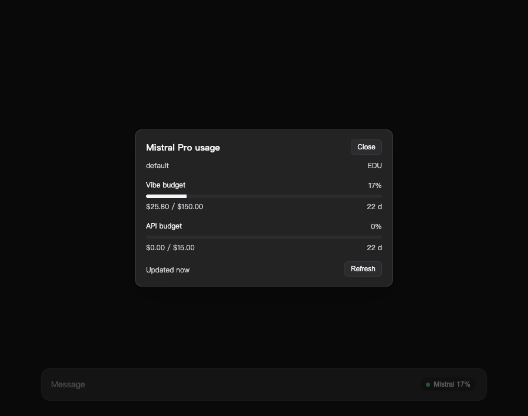
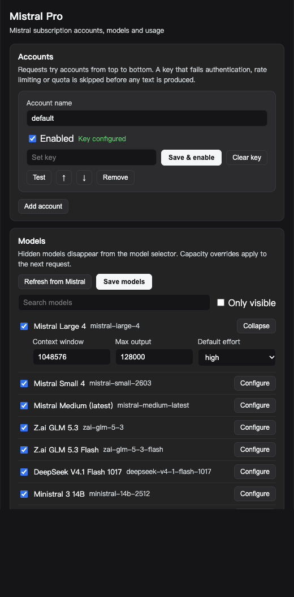

### dsh-mistral-pro

Connects Mistral subscriptions (Vibe Pro / Team) to DeepSeek Harness. Provides the `mistral-pro` model route, multi-account failover, and a usage popover in the composer toolbar.

   

[中文](README.md) · [English](README.en.md) · [日本語](README.ja.md)

---



## Installation

Requires DSH `>= 0.2.1-rc.5` and Node `^22.19.0 || >=24.0.0`.

Installing from a packed tarball is recommended:

```sh
npm pack
dsh plugin --profile desktop add /absolute/path/to/dsh-mistral-pro-0.1.0.tgz
```

For local development, you can link the working directory directly:

```sh
dsh plugin --profile desktop add /absolute/path/to/dsh-mistral-pro
```

Linking a directory creates a symlink. Because pnpm does not resolve `peerDependencies` for symlinked targets, the repo includes a `node_modules/@deepseek-ai/*` symlink directory pointing to the active profile's shared dependencies (excluded when packing the tarball).

Once installed, enable `dsh-mistral-pro` on the **Plugins** page and reload.

## Adding Accounts

Open **Settings → Mistral Pro → Accounts**:

1. Click **Add account** and enter a display name (used only for display and ordering).
2. Set **Credential reference** to an environment variable name, such as `MISTRAL_API_KEY`.
3. Paste your API key into the password field and click **Set key**. Keys are stored in the DSH credential store and are never sent back to the browser.
4. Click **Test** to run a check against `/v1/models`.

You can generate an API key under [Code › Vibe CLI](https://chat.mistral.ai/code/extensions). The same key works across Free, subscription plans, and pay-as-you-go; requests consume your monthly plan allowance first before falling back to pay-as-you-go billing.

Accounts are tried in list order (use ↑ / ↓ to adjust). The first enabled account acts as the primary. When a failover succeeds, the working account is promoted in memory for the rest of the process lifetime without modifying your saved config.

## Models

**Settings → Mistral Pro → Models** combines the built-in catalog with models returned by `/v1/models`. Uncheck **Visible** to hide a model from the picker. Context window, max output tokens, and **Default effort** (`reasoning_effort`) can be overridden per model.

Built-in catalog (2026-11, 19 models total, 11 visible by default). With a key, the live `/v1/models` listing wins and aliases collapse into one entry:

| Model | Context | Reasoning |
| --- | --- | --- |
| `mistral-large-4` | 1M | low / medium / high |
| `mistral-small-2603` | 256K | none / low / medium / high |
| `mistral-medium-3-5` | 128K | none / low / medium / high |
| `zai-glm-5-3` | 1M | low / high / max |
| `zai-glm-5-3-flash` | 1M | low / high / max |
| `deepseek-v4-1-flash-1017` | 1M | none / low / high / max |
| `ministral-3-{14b,8b,3b}-25-12` | 256K | — |
| `codestral-25-08` / `codestral-latest` | 256K | — |

`mistral-large-2512`, `devstral-2512`, and `mistral-medium-2508` are hidden by default and can be enabled in the model table.

## Usage Popover

The plugin adds a `● Mistral` button to the composer toolbar next to the OpenCode Go pill. Clicking it opens a usage panel showing:

- usage percentage, used / total quota, and reset countdown for each window;
- prepaid credit balance and current-month API spend;
- manual refresh and last-updated timestamp.

The toolbar button displays the first recognized quota window, prioritizing labels matching `Vibe`, `monthly`, or `plan`. Background tabs pause polling and refresh immediately when brought back into focus.

Usage comes from `api.mistral.ai/v1/billing/budget`, read with the API key you saved. No extra setup is needed. The endpoint returns the Vibe and API monthly budgets: percentage used, budget amount, and reset time.

If the key lacks the usage permission (the billing endpoint answers 403), you can use an admin-site cookie instead:

1. Sign in to [Mistral Admin](https://admin.mistral.ai/organization/usage).
2. Open DevTools → Network, select any request to `admin.mistral.ai`, and copy the full `Cookie` request header. It must include `ory_session_*` (if `csrftoken` is present, the plugin sends `X-CSRFTOKEN` automatically).
3. Paste the header under **Settings → Mistral Pro → Advanced** and click **Set cookie**.

The cookie path queries `GET /subscription`, `GET /api/billing/v2/usage?month=&year=`, and `GET /api/billing/credits` independently, so a failure on one endpoint won't block the others. If the session expires and redirects to the login page, the panel prompts you to update the cookie.

No cookie is needed when the key can read billing; the panel says what is missing when it cannot.

## Request Flow & Failover

The `llm` service passes session messages to the adapter, which formats them into OpenAI-compatible payloads, POSTs to `https://api.mistral.ai/v1/chat/completions`, and parses the SSE response into DSH `StreamChunk`s. Assistant reasoning history is replayed back as `thinking` chunks as required by Mistral's API.

Account failover only triggers before the stream emits content:

- On 401 / 403, 429, quota exhaustion, or a missing/invalid key, the adapter switches to the next account and places the failed one on a 300-second in-memory cooldown.
- Once text, reasoning, or a tool call has been emitted, errors are surfaced directly without switching accounts so partial responses from different accounts are never mixed.

## Settings

- **Accounts**: add, remove, reorder, enable/disable, store a key (save & enable), test connectivity.
- **Models**: toggle visibility, override context window, max output, and default reasoning effort.
- **Advanced**: automatic failover, cooldown, timeouts, catalog refresh, output cap, proxy, button display mode, refresh interval, and an optional cookie fallback.



All settings take effect immediately without restarting the plugin.

## Diagnostic Routes

Same-origin read-only routes registered for troubleshooting:

| Route | Description |
| --- | --- |
| `/plugins/dsh-mistral-pro/health` | account status, registered providers, model count |
| `/plugins/dsh-mistral-pro/meta` | active usage / advanced / accounts configuration |
| `/plugins/dsh-mistral-pro/models` | model catalog, visibility, limits, reasoning options |
| `/plugins/dsh-mistral-pro/usage?account=&force=1` | aggregated usage snapshot |
| `/plugins/dsh-mistral-pro/test?account=` | run a `/v1/models` check against a specific account |
| `/plugins/dsh-mistral-pro/refresh` | force a live model catalog refresh |
| `/plugins/dsh-mistral-pro/settings` | settings namespace and revision |

## Data & Privacy

- Chat requests are sent only to the configured Mistral API endpoint.
- Model catalog refreshes send only the API key and `User-Agent`.
- Usage queries are sent only to `admin.mistral.ai` (configurable) using the cookie you provide.
- API keys and cookies are stored in the host credential store; the browser only sees whether a credential is set.

## Known Limitations

- The `/v1/billing/budget` and admin usage endpoints are undocumented. The plugin reads them by field name, so upstream schema changes may hide individual windows.
- Mistral's public API does not provide a session cache-routing header comparable to `x-opencode-session`.
- Failover account promotion is kept in memory only and resets to the configured order when the process restarts.
- Image inputs require DSH's `attachments` service and fall back to placeholder text if unavailable.
- Proxy support requires `undici` to be resolvable in the host environment; otherwise proxied requests fail with an explicit error.

## Development

```sh
node --test test/      # 20 test cases
node --check index.js  # same for client.js and lib/*.js
```

Tests run against a local mock HTTP server simulating Mistral SSE streams and the admin endpoints, with no external network calls.

## License

MIT · by 01NGVI-QINGYI
