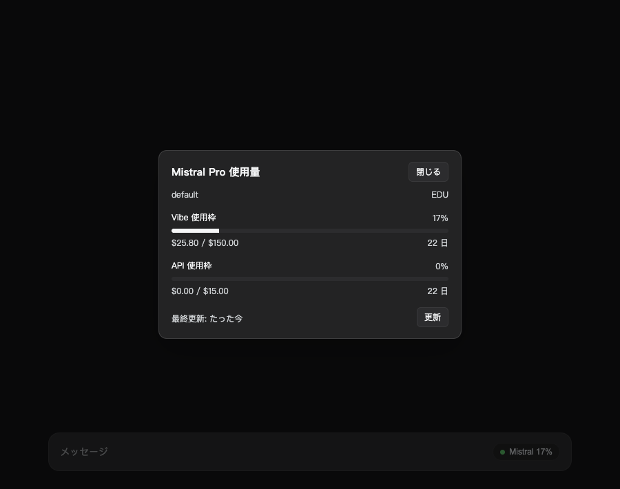
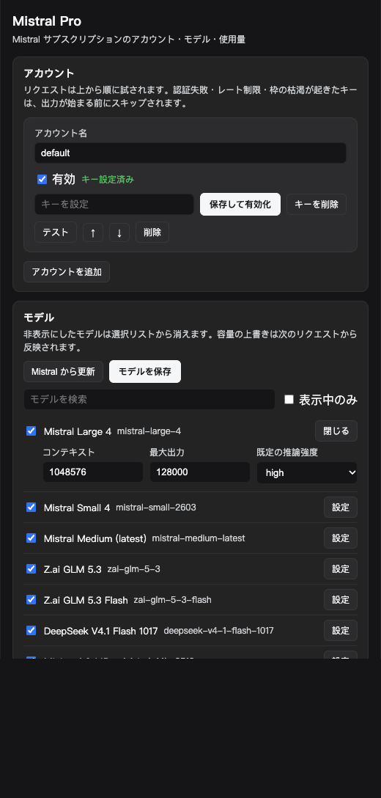

### dsh-mistral-pro

DeepSeek Harness で Mistral のサブスクリプション（Vibe Pro / Team）を利用するためのプラグインです。`mistral-pro` モデルルートの追加、複数アカウントのフェイルオーバー、入力欄ツールバーからの使用量確認に対応しています。

   

[中文](README.md) · [English](README.en.md) · [日本語](README.ja.md)

---



## インストール

動作環境: DSH `>= 0.2.1-rc.5`、Node `^22.19.0 || >=24.0.0`

パッケージ化した tarball からのインストールを推奨します。

```sh
npm pack
dsh plugin --profile desktop add /absolute/path/to/dsh-mistral-pro-0.1.0.tgz
```

開発時はディレクトリを直接指定してリンクすることも可能です。

```sh
dsh plugin --profile desktop add /absolute/path/to/dsh-mistral-pro
```

ディレクトリ指定ではシンボリックリンクが作成されます。pnpm はリンク先の `peerDependencies` を解決しないため、リポジトリ内には現在の profile の共有依存を参照する `node_modules/@deepseek-ai/*` のリンクを同梱しています（tarball には含まれません）。

追加後、**Plugins** ページで `dsh-mistral-pro` を有効化し、ページを再読み込みしてください。

## アカウントの登録

**Settings → Mistral Pro → Accounts** を開きます。

1. **Add account** をクリックし、表示用のアカウント名を入力します（表示と並び順のみに使用されます）。
2. **Credential reference** に `MISTRAL_API_KEY` などの環境変数名を指定します。
3. パスワード欄に API キーを貼り付けて **Set key** を押します。キーは DSH のクレデンシャルストアに保存され、ブラウザ側には再表示されません。
4. **Test** を押すと `/v1/models` にリクエストを送り、疎通を確認します。

API キーは [Code › Vibe CLI](https://chat.mistral.ai/code/extensions) から発行できます。同じキーで無料枠・有料プラン・従量課金のすべてに対応しており、リクエスト時はプランの月次枠から優先的に消費され、超過分が従量課金になります。

複数アカウントを登録した場合はリストの上から順に使用されます（↑ / ↓ で並び替え可能）。最上位の有効なアカウントがメインとなり、エラーで別アカウントへ切り替わった場合はプロセス終了までメモリ上で優先順位が入れ替わります（設定ファイル自体は書き換わりません）。

## モデル管理

**Settings → Mistral Pro → Models** には、内蔵カタログと `/v1/models` から取得したモデルが一覧表示されます。**Visible** のチェックを外すとモデル選択リストから非表示になります。コンテキスト長・最大出力トークン数・**Default effort**（リクエスト時の `reasoning_effort`）はモデル単位で変更できます。

内蔵カタログ（2026-11 時点、全 19 件・既定で 11 件表示）。キーがある場合は `/v1/models` を優先し、同じモデルの別名は 1 件にまとめます:

| モデル | コンテキスト | 推論強度 |
| --- | --- | --- |
| `mistral-large-4` | 1M | low / medium / high |
| `mistral-small-2603` | 256K | none / low / medium / high |
| `mistral-medium-3-5` | 128K | none / low / medium / high |
| `zai-glm-5-3` | 1M | low / high / max |
| `zai-glm-5-3-flash` | 1M | low / high / max |
| `deepseek-v4-1-flash-1017` | 1M | none / low / high / max |
| `ministral-3-{14b,8b,3b}-25-12` | 256K | — |
| `codestral-25-08` / `codestral-latest` | 256K | — |

`mistral-large-2512`、`devstral-2512`、`mistral-medium-2508` は初期状態で非表示になっており、必要に応じて一覧から有効化できます。

## 使用量パネル

入力欄ツールバー（OpenCode Go ピルの右隣）に `● Mistral` ボタンが追加され、クリックすると以下の情報を確認できます。

- 各使用枠の消化率、使用量 / 上限、リセットまでの残り時間
- プリペイド残高と当月の API 利用額
- 手動更新ボタンと最終更新時刻

ツールバー上のボタンには、`Vibe`・`monthly`・`plan` を含むラベルを優先して最初に見つかった使用枠が表示されます。タブがバックグラウンドにある間はポーリングを一時停止し、フォアグラウンドに戻ると即座に更新します。

使用量は `api.mistral.ai/v1/billing/budget` から、保存した API キーで直接取得します。追加設定は不要です。Vibe と API の月次予算（使用率、予算額、リセット日時）が返ります。

このキーに usage 権限がない場合（請求エンドポイントが 403 を返す場合）は、管理サイトの Cookie でも取得できます。

1. [Mistral Admin](https://admin.mistral.ai/organization/usage) にログインします。
2. ブラウザの DevTools → Network を開き、`admin.mistral.ai` 宛ての任意のリクエストから `Cookie` ヘッダー全体をコピーします（`ory_session_*` が必須です。`csrftoken` が含まれている場合は `X-CSRFTOKEN` ヘッダーも自動付与されます）。
3. **Settings → Mistral Pro → Advanced** に貼り付け、**Set cookie** を押します。

Cookie を使う場合は `GET /subscription`、`GET /api/billing/v2/usage?month=&year=`、`GET /api/billing/credits` の 3 つのエンドポイントを個別に呼び出します。一部が失敗しても他の項目はそのまま表示されます。セッション切れでログイン画面へリダイレクトされた場合は、Cookie の再設定を促すメッセージが表示されます。

キーで請求を読める場合は Cookie は不要です。読めない場合のみパネルに案内が出ます。

## リクエスト処理とフェイルオーバー

`llm` サービスから渡されたメッセージはアダプター側で OpenAI 互換形式に変換され、`https://api.mistral.ai/v1/chat/completions` へ POST されます。返却された SSE ストリームを 1 行ずつパースし、DSH の `StreamChunk` として出力します。過去の assistant メッセージに含まれる reasoning は、Mistral API の仕様に合わせて `thinking` チャンクとして再送されます。

アカウントのフェイルオーバーは、ストリームの出力が始まる前にのみ行われます。

- 401 / 403、429、上限到達、キーの未設定・形式不正が発生した場合は次のアカウントへ切り替え、失敗したアカウントはメモリ上で 300 秒間クールダウンに入ります。
- テキスト・推論・ツール呼び出しのいずれかがすでに出力された後は、複数アカウントの応答が混ざるのを防ぐため切り替えを行わず、そのままエラーを返します。

## 設定項目

- **Accounts**: アカウントの追加・削除、並び替え、有効/無効、API キーの保存（保存して有効化）、疎通テスト
- **Models**: 表示切り替え、コンテキスト長、最大出力トークン数、既定の推論強度
- **Advanced**: 自動フェイルオーバー、クールダウン、タイムアウト、カタログ更新、出力上限、プロキシ、ボタンの表示モード、更新間隔、任意の Cookie フォールバック



設定の変更はすべて即座に反映され、プラグインの再起動は不要です。

## 診断用ルート

状態確認やトラブルシューティング用に、同一オリジンの読み取り専用ルートを提供しています。

| ルート | 内容 |
| --- | --- |
| `/plugins/dsh-mistral-pro/health` | アカウント設定の有無、登録済み provider、モデル数 |
| `/plugins/dsh-mistral-pro/meta` | 現在有効な usage / advanced / accounts 設定 |
| `/plugins/dsh-mistral-pro/models` | モデルカタログ、表示状態、上限値、推論設定 |
| `/plugins/dsh-mistral-pro/usage?account=&force=1` | 集約された使用量スナップショット |
| `/plugins/dsh-mistral-pro/test?account=` | 指定アカウントでの `/v1/models` 疎通確認 |
| `/plugins/dsh-mistral-pro/refresh` | モデルカタログの即時更新 |
| `/plugins/dsh-mistral-pro/settings` | 設定の名前空間と revision |

## データとプライバシー

- チャット内容は設定した Mistral エンドポイントにのみ送信されます。
- モデルカタログの取得時は API キーと `User-Agent` のみを送信し、会話内容は一切含みません。
- 使用量の取得は `admin.mistral.ai`（変更可）に対してのみ行われ、登録した Cookie が使用されます。
- API キーと Cookie はホスト側のクレデンシャルストアに保管され、ブラウザ側には「設定済みかどうか」のみが返されます。

## 制限事項

- `/v1/billing/budget` と管理サイトの使用量 API は非公開仕様です。フィールド名で読み取っているため、上流の構造変更で一部の枠が表示されないことがあります。
- Mistral の公開 API には `x-opencode-session` に相当するセッションキャッシュ用ヘッダーがありません。
- フェイルオーバーによるアカウント順位の繰り上げはメモリ上でのみ保持され、プロセス再起動時には設定順に戻ります。
- 画像入力には DSH の `attachments` サービスが必要です。利用できない環境ではプレースホルダー文字列に置き換わります。
- プロキシ機能はホスト環境で `undici` を解決できる必要があります（解決できない場合はエラーを返します）。
- 設定画面の UI 表記は現在英語と中国語のみ対応しており、日本語環境では英語表示にフォールバックします。

## 開発・テスト

```sh
node --test test/      # 20 ケース
node --check index.js  # client.js と lib/*.js も同様
```

テストはローカルのモック HTTP サーバーで Mistral の SSE ストリームと管理サイトを再現するため、外部通信や枠の消費は発生しません。

## License

MIT · by 01NGVI-QINGYI
