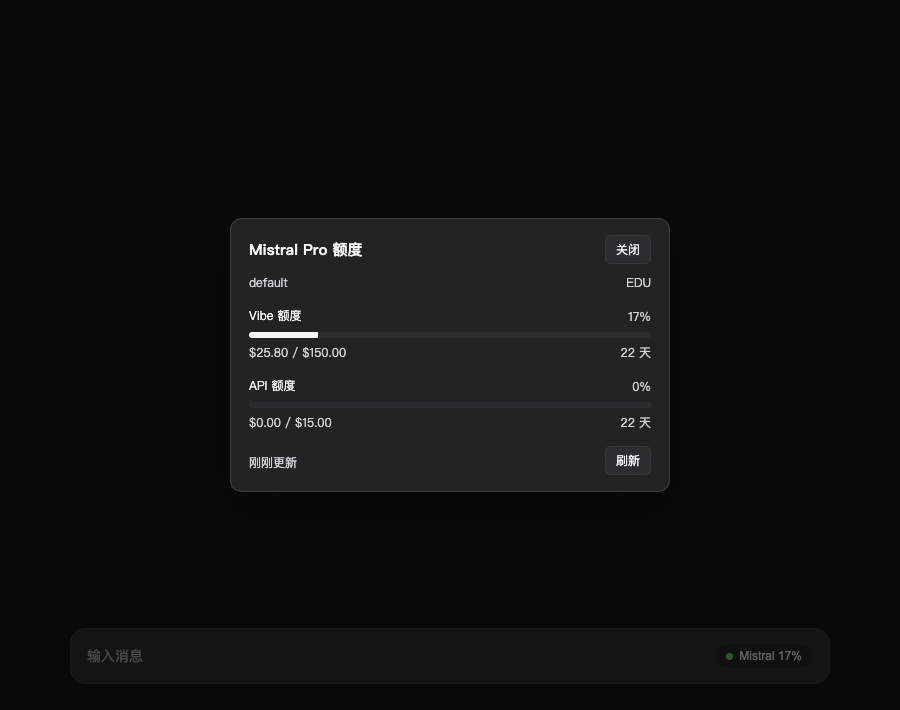
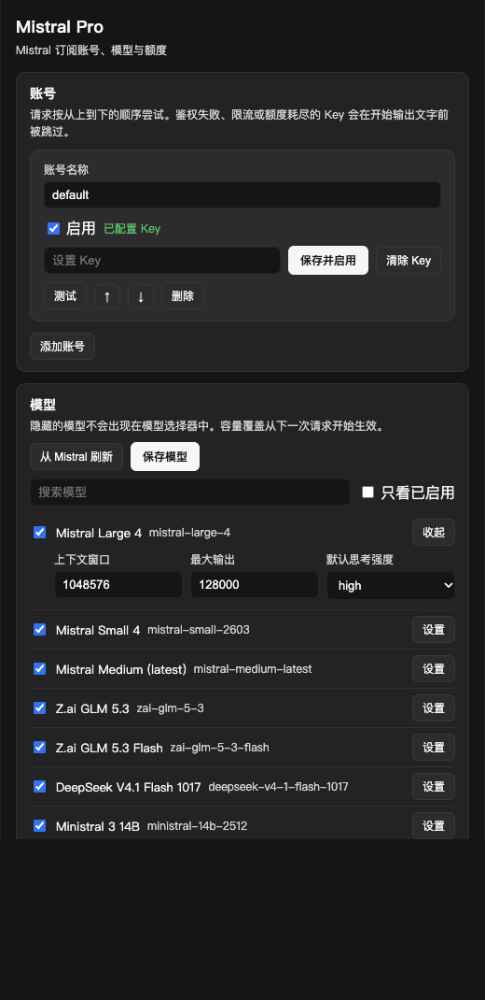

### dsh-mistral-pro

在 DeepSeek Harness 中接入 Mistral 订阅（Vibe Pro / Team），提供 `mistral-pro` 模型路由、多账号故障切换和输入框工具栏的额度面板。

   

[中文](README.md) · [English](README.en.md) · [日本語](README.ja.md)

---



## 安装

环境要求：DSH `>= 0.2.1-rc.5`，Node `^22.19.0 || >=24.0.0`。

推荐打包成 tarball 安装：

```sh
npm pack
dsh plugin --profile desktop add /absolute/path/to/dsh-mistral-pro-0.1.0.tgz
```

本地开发也可以直接挂载目录：

```sh
dsh plugin --profile desktop add /absolute/path/to/dsh-mistral-pro
```

按目录添加会创建符号链接。由于 pnpm 不会为符号链接解析 `peerDependencies`，仓库内预置了指向当前 profile 共享依赖的 `node_modules/@deepseek-ai/*` 软链（打包 tarball 时不会包含）。

安装后到 **插件** 页面启用 `dsh-mistral-pro`，刷新页面即可。

## 添加账号

打开 **设置 → Mistral Pro → 账号**：

1. 点击「添加账号」并填写名称（仅用于界面展示和排序）。
2. 「凭据引用」填一个环境变量名，如 `MISTRAL_API_KEY`。
3. 在密码框粘贴 API Key，点击「设置 Key」。Key 保存在 DSH 凭据存储中，前端不会回显。
4. 点击「测试」，调用一次 `/v1/models` 验证连通性。

API Key 可在 [Code › Vibe CLI](https://chat.mistral.ai/code/extensions) 页面创建。同一个 Key 通用于免费档、订阅套餐和按量付费；调用时会优先扣减套餐内的月度额度，用尽后再走按量计费。

配置多个账号时会按列表顺序调用，可用 ↑ / ↓ 调整优先级，排在第一位且已启用的为主账号。触发容灾切换后，可用账号会在当前进程内临时提为首选，不会改动配置文件。

## 模型

**设置 → Mistral Pro → 模型** 会合并展示内置模型列表与 `/v1/models` 返回的模型。取消勾选「显示」可从模型选择器中隐藏；上下文窗口、最大输出长度和默认 `reasoning_effort`（思考强度）均可按模型单独调整。

内置目录（2026-11，共 19 个，默认显示 11 个）。有 Key 时以 `/v1/models` 为准，同一模型的别名会合并成一项：

| 模型 | 上下文 | 思考强度 |
| --- | --- | --- |
| `mistral-large-4` | 1M | low / medium / high |
| `mistral-small-2603` | 256K | none / low / medium / high |
| `mistral-medium-3-5` | 128K | none / low / medium / high |
| `zai-glm-5-3` | 1M | low / high / max |
| `zai-glm-5-3-flash` | 1M | low / high / max |
| `deepseek-v4-1-flash-1017` | 1M | none / low / high / max |
| `ministral-3-{14b,8b,3b}-25-12` | 256K | — |
| `codestral-25-08` / `codestral-latest` | 256K | — |

`mistral-large-2512`、`devstral-2512`、`mistral-medium-2508` 默认隐藏，需要时可在模型列表中开启。

## 额度面板

输入框工具栏右侧（OpenCode Go 胶囊旁）会多出一个 `● Mistral` 按钮，点击可查看：

- 各周期额度的使用比例、已用 / 总量及重置倒计时；
- 预付余额与当月 API 账单消耗；
- 手动刷新按钮与上次更新时间。

按钮上默认展示第一个匹配 `Vibe`、`monthly` 或 `plan` 的额度窗口。页面切到后台时暂停轮询，切回前台时立即刷新。

额度数据来自 `api.mistral.ai/v1/billing/budget`，用你保存的 API Key 直接读取，不需要额外配置。接口返回 Vibe 和 API 两个月度预算：已用百分比、预算金额、重置时间。

如果这个 Key 没有 usage 权限（账单接口返回 403），可以改用管理站点 Cookie：

1. 登录 [Mistral Admin](https://admin.mistral.ai/organization/usage)。
2. 打开浏览器开发者工具 → Network，任选一条发往 `admin.mistral.ai` 的请求，复制完整的 `Cookie` 请求头（需包含 `ory_session_*`；若含 `csrftoken`，插件会自动附带 `X-CSRFTOKEN`）。
3. 打开 **设置 → Mistral Pro → 高级设置**，粘贴并点击「设置 Cookie」。

Cookie 路径会请求 `GET /subscription`、`GET /api/billing/v2/usage?month=&year=` 和 `GET /api/billing/credits`，单个接口失败不影响其余数据展示；会话过期跳转到登录页时会在面板内提示更换。

Key 能读账单时不需要 Cookie；读不到时面板会说明原因。

## 请求与容灾

`llm` 服务将对话交给插件适配器后，会转换为 OpenAI 兼容格式并 POST 到 `https://api.mistral.ai/v1/chat/completions`，逐行解析 SSE 流并转为 DSH 的 `StreamChunk`。历史 assistant 消息中的 reasoning 会按 Mistral 的格式要求还原为 `thinking` 块发回。

多账号切换仅在流式输出开始前触发：

- 遇到 401 / 403、429、额度耗尽、Key 缺失或格式错误时，自动尝试下一个账号，原账号默认冷却 300 秒。
- 一旦已经产出正文、思考内容或工具调用，报错时直接中止，不再中途换号，以免把两个账号的回复拼在一起。

## 设置项

- **账号**：增删、排序、启停、写入 Key（保存并启用）、连通性测试。
- **模型**：显示开关、上下文窗口、最大输出、默认思考强度。
- **高级**：自动容灾、冷却、超时、目录刷新、输出上限、代理、按钮显示模式、刷新间隔，以及可选的 Cookie 兜底。



所有设置项改动后立即生效，无需重启插件。

## 调试路由

插件注册了以下同源只读路由，便于排查状态：

| 路由 | 说明 |
| --- | --- |
| `/plugins/dsh-mistral-pro/health` | 账号是否就绪、已注册的 provider、模型数量 |
| `/plugins/dsh-mistral-pro/meta` | 当前生效的 usage / advanced / accounts 配置 |
| `/plugins/dsh-mistral-pro/models` | 模型目录、可见性、上下文容量与思考强度 |
| `/plugins/dsh-mistral-pro/usage?account=&force=1` | 聚合后的额度快照 |
| `/plugins/dsh-mistral-pro/test?account=` | 用指定账号测试一次 `/v1/models` |
| `/plugins/dsh-mistral-pro/refresh` | 立即刷新远端模型目录 |
| `/plugins/dsh-mistral-pro/settings` | 设置命名空间与 revision |

## 数据与隐私

- 对话内容仅发往你配置的 Mistral API 端点。
- 拉取模型目录时仅携带 API Key 和 `User-Agent`，不含对话内容。
- 额度查询仅请求 `admin.mistral.ai`（端点可改）并携带你填入的 Cookie。
- Key 与 Cookie 均保存在宿主凭据系统中，前端只能读取「是否已配置」状态。

## 已知限制

- `/v1/billing/budget` 与管理站点的额度接口都没有公开文档，插件按字段名读取；上游调整结构时部分窗口可能无法识别。
- Mistral 公开 API 没有类似 `x-opencode-session` 的会话缓存路由头。
- 容灾切换后的账号顺位只保留在内存中，进程重启后恢复为配置顺序。
- 图片输入依赖 DSH 的 `attachments` 服务；缺失时会退化为文本占位符。
- 代理功能要求宿主环境可解析 `undici`，否则请求会直接报错。

## 开发与测试

```sh
node --test test/      # 20 个测试用例
node --check index.js  # client.js 和 lib/*.js 同理
```

测试通过本地 HTTP 服务模拟 Mistral SSE 流与管理后台接口，不发起外网请求，也不消耗额度。

## License

MIT · by 01NGVI-QINGYI
